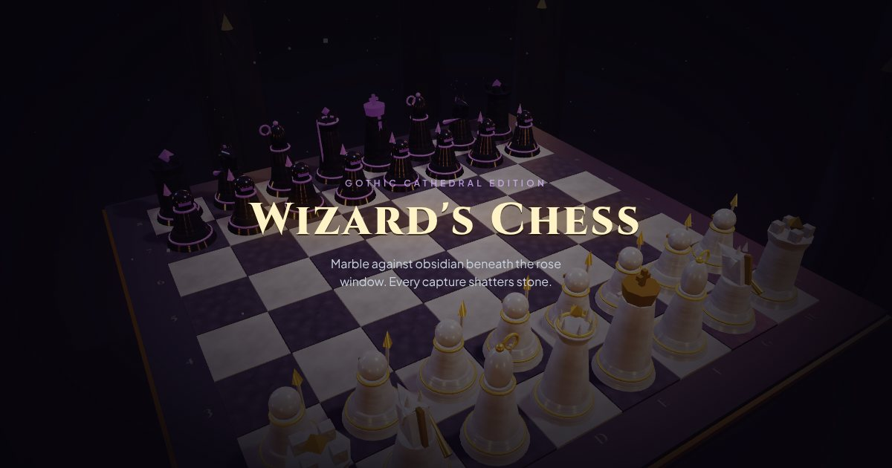

# Wizard's Chess

Wizard's Chess 3D, Gothic Cathedral Edition. Marble against obsidian beneath the rose window, where every capture shatters stone.

**▶ Play now: [wizard-chess-red.vercel.app](https://wizard-chess-red.vercel.app/)**

[](https://wizard-chess-red.vercel.app/)

## Features

- Full chess rules: castling, en passant, promotion, check, checkmate and stalemate
- Play against the AI or a friend on the same device
- AI runs in a Web Worker (alpha-beta search with quiescence), so the scene keeps animating while it thinks
- Animated attacks and shattering captures, synthesized sound, and camera presets
- Hints and undo

## Run locally

Everything is in a single `index.html`, with no build step. Open it in a browser, or serve the folder:

```sh
npx serve .
```

Three.js, Tailwind and fonts load from CDNs, so you need an internet connection.
